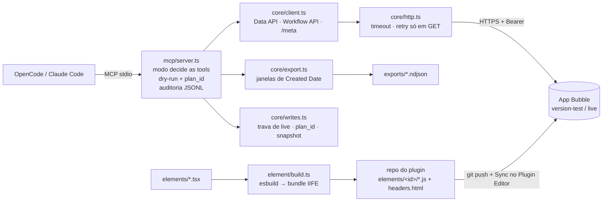

# Bubble Bridge 0.4

Servidor MCP + CLI em Node/TypeScript que liga o OpenCode (ou Claude Code) a um app Bubble.io usando só caminhos oficiais:

- **Motor 1 — runtime:** leitura e escrita no banco e execução de backend workflows pela Data API e Workflow API, com guardas de escrita.
- **Motor 3 — elementos:** compila componentes TS/React para os arquivos de um elemento de plugin, prontos para o sync com o GitHub.

O Motor 2 (compilador TS → `.bubble`) depende da PoC-0, que precisa de um export real do app.

## Arquitetura



## Instalação

```bash
npm install && npm run build
cp .env.example .env && chmod 600 .env
node dist/cli.js doctor
```

No editor do Bubble (Settings > API): habilite a Data API para os tipos desejados, a documentação Swagger e, para escrita, marque Create/Modify/Delete via API nas privacy rules de cada tipo.

## Variáveis de ambiente

| Variável | Padrão | Efeito |
| --- | --- | --- |
| `BUBBLE_APP_URL` | — | URL do app (obrigatória para tudo, menos `element build`) |
| `BUBBLE_API_TOKEN` | vazio | Token da aba API. O de admin ignora privacy rules |
| `BUBBLE_ENV` | `test` | `test` usa `/version-test`; `live` usa o app publicado |
| `BUBBLE_MODE` | `read-only` | `read-write` registra criar/alterar/workflow; `admin` registra também apagar |
| `BUBBLE_ALLOW_LIVE_WRITES` | `false` | Sem `true`, qualquer escrita no live é recusada, até em dry-run |
| `BUBBLE_WORKFLOW_ALLOWLIST` | vazio | Workflows que `bubble_workflow_run` pode disparar (lista separada por vírgula) |
| `BUBBLE_AUDIT_LOG` | desligado | Log JSONL de cada chamada (sem token e sem payload) |
| `BUBBLE_EXPORT_DIR` | `./exports` | Exportações e snapshots de registros apagados |

## Tools MCP

| Tool | Modo mínimo | Endpoint |
| --- | --- | --- |
| `bubble_config` | read-only | — |
| `bubble_schema` | read-only | `/meta/swagger.json` em fatias: `list_types`, `get_type`, `list_workflows`, `get_workflow` |
| `bubble_query` | read-only | `GET /obj/{type}` — `action`: `list` (página, com projeção `fields`), `count` (total em 1 requisição), `get` (por id) |
| `bubble_data_export` | read-only | `GET /obj/{type}` paginado → NDJSON |
| `bubble_data_create` | read-write | `POST /obj/{type}` |
| `bubble_data_bulk_create` | read-write | `POST /obj/{type}/bulk` em lotes |
| `bubble_data_update` | read-write | `PATCH /obj/{type}/{id}` |
| `bubble_workflow_run` | read-write | `POST /wf/{name}` (só allowlist) |
| `bubble_workflow_run_many` | read-write | `POST /wf/{name}` até 50 disparos com um plan_id; para no 1º erro |
| `bubble_workflow_create` | read-write | `POST /obj/{type}` + `POST /wf/{name}` no mesmo plan_id (o workflow já deve existir no app) |
| `bubble_data_delete` | admin | snapshot + `DELETE /obj/{type}/{id}` |
| `bubble_exposure_audit` | read-only | GET **sem token** em N tipos → quais vazam, com gravidade |
| `bubble_anonymous_read` | read-only | PoC: GET sem token em 1 tipo |

Respostas valem `structuredContent` + texto compacto; **teto de 16 KB por resposta** (arrays grandes são cortados e marcados `_truncated`) e **fila de 6 chamadas em voo** para não rajada na Data API. As tools `bubble_data_query`, `bubble_data_get` e `bubble_schema_discover` da v0.2 foram substituídas por `bubble_query` e `bubble_schema`.

### Como uma escrita acontece

1. O agente chama a tool. `dry_run` é `true` por padrão: nada é alterado e a resposta traz o plano (método, endpoint, prévia do payload) e um `plan_id`.
2. Para executar, chama de novo com os **mesmos argumentos**, `dry_run=false` e o `plan_id`. Se qualquer argumento mudou, o hash não bate e a execução é recusada. O `plan_id` só vale se emitido por um dry-run neste processo, por 15 min, e é de **uso único**: consumido antes de executar, mesmo se a execução falhar (gere novo dry-run).
3. Escritas nunca são repetidas automaticamente. Um lote `/bulk` com resposta incompleta interrompe a operação e informa o que já foi criado.

A aprovação humana fica no cliente MCP: mantenha as tools de escrita exigindo confirmação no OpenCode ou no Claude Code.

## Elementos de plugin (Motor 3)

Fluxo de uma vez por elemento:

1. No Plugin Editor, crie o elemento e declare os fields (o `name` de cada field é o nome da propriedade no código), os estados expostos e os eventos.
2. Conecte o plugin ao GitHub e sincronize. Plugins gratuitos só sincronizam depois que você publicou um item no Marketplace ou se registrou como vendedor.
3. Clone o repositório do plugin.

Fluxo de cada mudança:

```bash
node dist/cli.js element build --entry elements/contador/index.tsx --plugin-dir ../meu-plugin
cd ../meu-plugin && git commit -am "contador" && git push
# Plugin Editor → Settings → Synchronize with GitHub
```

Sem GitHub, use `--out build/elements` e cole cada arquivo na aba correspondente do Plugin Editor.

O componente:

```tsx
import { defineElement } from "bubble-bridge/element";

export default defineElement<{ titulo: string }, "valor", "mudou">({
  name: "contador",          // chave técnica do bundle
  display: "Contador BB",    // nome do elemento no Plugin Editor
  properties: { titulo: "text" },
  states: ["valor"],
  events: ["mudou"],
  render: (props, api) => <button onClick={() => { api.publishState("valor", 1); api.triggerEvent("mudou"); }}>{props.titulo}</button>,
});
```

O que o build garante:

- Grava `headers.html` (bundle) e `initialize/update/reset/preview.js` na pasta do elemento cujo `display` bate. **Nunca** escreve `params.json`: os ids dos fields são referenciados pelos apps.
- Falha se o código usa um field que o Plugin Editor não declarou.
- Não sobrescreve código escrito à mão sem `--force`: cada arquivo gerado leva no marker o sha256 do próprio conteúdo (sem a linha do marker); arquivo editado, sem hash válido (versão antiga) ou com marker adulterado conta como editado à mão. Nenhum arquivo extra é criado na pasta do elemento.
- Erro de render aparece no canvas do elemento, sem derrubar a página.
- `reset` remonta o componente; `null` vindo do Bubble vira o padrão do componente.

## Auditoria de exposição (v0.3)

Testa a Data API **sem o header Authorization** — o ponto de vista de um atacante anônimo — e
classifica a gravidade do que responde 200:

| Nível | Significado |
| --- | --- |
| `critical` | credencial/segredo reutilizável legível (campo tipo `chave de atenticacao`, `senha`, `token`) |
| `high` | dado pessoal (LGPD art. 5º) ou dado sensível de negócio |
| `low` | dado de negócio exposto, sem pessoal aparente |
| `none` | privacy rule bloqueia a leitura anônima |

```bash
node dist/cli.js exposure --type colaboradores   # PoC de um tipo
node dist/cli.js exposure                        # varre os tipos com nome sensível
node dist/cli.js exposure --live                 # audita o app publicado
node dist/cli.js exposure --all --concurrency 3  # varre os 291 tipos (tráfego de varredura)
```

Via MCP: `bubble_exposure_audit` (varredura, com `env=both` para testar os dois ambientes) e
`bubble_anonymous_read` (PoC de um tipo). Por padrão a resposta traz só nomes de campo; valores
de registro só aparecem mascarados, e só quando `include_sample=true`.

**O que isso encontrou no app `comprover`** (2026-10-17, ambos os ambientes):

| Tipo | Registros legíveis sem token | Campos expostos |
| --- | --- | --- |
| `tabela_log_altercao_rh` | ~3 (live) | `chave de atenticacao` — **credencial em texto plano** |
| `controledeassinaturas` | ~944.648 (live) | `cnpj do emissor`, cliente, nota, valor |
| `movimentaçãodeveiculos` | ~265.738 (live) | `latitude`, `longetude`, chave de nota fiscal |
| `colaboradores` | ~1.156 (live) | `Data de nascimento` |
| `meusexecutáveisedocumentos` | ~5 (live) | `nome` |
| `modelodeemail` | ~45 | texto de modelo |

A causa é sempre a mesma e **não envolve o token**: privacy rule de leitura marcada como
"everyone" em Settings > Privacy. Qualquer pessoa com a URL do app faz essas requisições hoje.
Correção: desmarcar leitura anônima nesses tipos, rotacionar a `chave de atenticacao` que já está
vazada, e considerar desligar "Enable Swagger documentation" no app publicado (hoje o swagger
devolve os 291 tipos e 191 workflows a qualquer visitante).

**Limitação**: a classificação é heurística, por nome de campo. Ela ordena o que corrigir
primeiro; não substitui a análise manual das privacy rules.

## Servir por HTTP (execução remota)

O `serve` padrão é stdio. Para vários clients consumirem um servidor só, use o transporte
Streamable HTTP com **um token por client**. O deploy em stack do Portainer, na rede interna,
está em [`docs/deploy.md`](docs/deploy.md).

```bash
export BUBBLE_BRIDGE_CLIENTS_FILE=./clients.json
node dist/cli.js clients add hugo --mode read-write   # imprime o token uma vez; o arquivo guarda o sha256
node dist/cli.js serve --http --port 8787             # bind 127.0.0.1 por padrão
```

- Modo efetivo do client = `min(modo do client, BUBBLE_MODE)`; `clients revoke` vale sem restart.
- `BUBBLE_BRIDGE_HTTP_TOKEN` (token único) continua aceito quando não há arquivo de clients: vira o client `default`.
- A auditoria registra o nome do client; `bubble_data_export` só existe no stdio.
- Stateless, com corpo limitado a 8 MB, 32 requisições em voo e 120 req/min por IP e por client.
  Também recusa `Origin` fora de `BUBBLE_BRIDGE_ALLOWED_ORIGINS` e encerra limpo em SIGTERM.
- `GET /healthz` é público e não devolve dados.

## Notas da fusão (v0.1 + v0.2)

- `.env` é procurado em `BUBBLE_ENV_FILE`, depois no diretório atual, depois na raiz do pacote — o `serve` funciona iniciado de qualquer pasta.
- `bubble_data_export` grava arquivo local, por isso não é `readOnlyHint`; se falhar, o arquivo parcial é apagado. Exports ficam em texto puro em `exports/` (ignorado pelo git).

## Testes

```bash
npm test           # 117 testes: http, cliente, export, escrita, MCP, build e runtime de elementos em jsdom
npm run typecheck  # código, testes e elementos
```

## O que ainda não foi verificado contra o Bubble real

- [ ] Escrita: rodar `create` → `update` → `delete` num tipo de teste em `version-test`.
- [ ] `/bulk`: confirmar o formato de resposta por linha com um item inválido no lote.
- [ ] Elemento: sync do `contador` num plugin real, uso numa página, e conferir se estados e eventos aparecem no editor com os nomes do código.
- [ ] Formato de estados e eventos no `params.json` depois do sync — o build hoje só avisa que não consegue confirmar. Se você me mandar esse arquivo, a checagem passa a ser estrita.
- [ ] Tamanho do `headers.html`: o bundle com React 19 tem cerca de 220 KB por elemento. Se o Bubble limitar headers ou vários elementos pesarem, o próximo passo é um React compartilhado no header do plugin, ou Preact.
- [ ] Itens da PoC-1 ainda pendentes: teto de `limit=100` e comportamento de `remaining` perto de 50.000.
